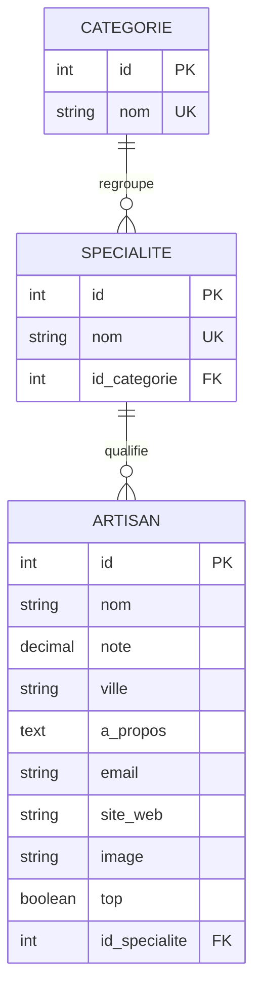

# MCD — Trouve ton artisan

Le modèle conceptuel reprend les trois entités demandées par le plan maître. La ville est un attribut de l'artisan, comme dans le jeu de données fourni.

## Règles de gestion

- Une catégorie peut regrouper zéro à plusieurs spécialités; une spécialité appartient à une seule catégorie.
- Une spécialité peut concerner zéro à plusieurs artisans; chaque artisan possède une seule spécialité.
- La note est comprise entre 0 et 5.
- Le site web et l'image sont facultatifs.
- Le jeu d'essai contient quatre catégories, quinze spécialités, dix-sept artisans et trois artisans mis en avant.

Le MCD est matérialisé dans [`creation.sql`](../../database/scripts/creation.sql).
